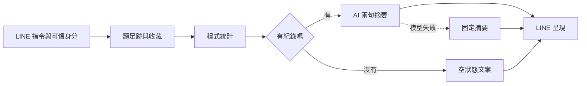

# 用既有 LINE Cafe Bot，15 天看懂 Google ADK

每天 **45～60 分鐘**，用一到兩個相關概念搭配一個小實作，再寫一篇短文。學完能用自己的咖啡 Bot 說明 ADK 的用途，並準備十五分鐘分享。

**先看 [15 天 roadmap](ROADMAP.md)，今天從 [Day 01](lessons/day-01.md) 開始。** Day 1 的離線練習不需要 API key。

## 主線：改造本月咖啡護照

這是逐日實作的目標架構。已提供教材、文章草稿、離線練習與最小 agent 起點；完整 ADK／Firestore／LINE 整合仍是待完成任務。

選擇這條主線，是因為既有 `line-cafe-passport` 已分開資料讀取、統計、摘要與卡片，適合小範圍改造。依 2026-10-24 查核，已讀 13 個舊 `line-cafe-*` repo 的 README、檔案樹與代表程式，另查看 5 個相關專案，詳見[盤點](docs/repo-audit.md)。

## 六個 phase

| Phase | 天數 | 重點 | 成果 |
| --- | --- | --- | --- |
| 1 | 1～2 | Graph、ADK 分工與第一個 agent | 系統圖與 agent |
| 2 | 3～5 | Instruction、tools、schema、session、events | 可追蹤的工具查詢 |
| 3 | 6～8 | 順序、資料契約、分支與舊統計 | 小 graph 與前後比對 |
| 4 | 9～10 | Adapter、摘要與 fallback | 三種本機情境 |
| 5 | 11～13 | LINE、身分、確認觀念、trace 與驗收 | 五案例與比較表 |
| 6 | 14～15 | 主文編輯、錄影與彩排 | 十五分鐘分享包 |

## 每天怎麼用

1. 花 10～15 分鐘讀當日的兩個相連觀念與一個 Cafe Bot 情境。
2. 花 25～30 分鐘完成三個小步驟，留下一個可檢查的成果。
3. 花 10～15 分鐘改寫文章草稿、補入真實輸出，更新[學習紀錄](learning-log.md)。

文章預設每天 300～500 字。Day 1、Day 2 已整理成完整文章，後面 13 篇是短文草稿，實作結果由每天補入。Day 5、10、15 保留整理時間；可隔天學一次，用剩餘時間複習與準備分享。

## 文件入口

| 想做什麼 | 入口 |
| --- | --- |
| 今日 Medium 文章 | [medium.md](medium.md) |
| 找每天的任務與文章 | [ROADMAP](ROADMAP.md)、[lessons](lessons/README.md)、[articles](articles/README.md) |
| 第一天就動手 | [離線資料流練習](examples/README.md)與[完整概念文章](articles/day-01.md) |
| Day 2 跑 agent | [TypeScript starter](examples/adk-starter/README.md) |
| 查角色與名詞 | [目標架構](docs/architecture.md)、[概念速查](docs/concepts.md) |
| 重用舊程式 | [盤點](docs/repo-audit.md)與[遷移指南](docs/migration.md) |
| 準備分享 | [Demo 與驗收](docs/demo.md)、[十五分鐘提綱](docs/talk.md)、[寫作指南](docs/writing.md) |

## 版本與範圍

沿用 TypeScript，學習 ADK 2.x Workflow；版本與官方來源見[資源筆記](docs/resources.md)。1.x 常見的 SequentialAgent／ParallelAgent／LoopAgent 在 2.x 有棄用說明，閱讀舊範例要區分版本。[官方 2.0 說明](https://adk.dev/2.0/)

截至 2026-10-24，官方 TypeScript Quickstart 列出 Node ≥24.13.0、npm ≥11.8.0，與舊 Bot 的 Node 20 環境分開確認。[官方 Quickstart](https://adk.dev/get-started/typescript/)

先做單一 agent、唯讀 tools 與小 graph。並行與人類確認先用圖解，多 agent、RAG、MCP、A2A 與完整部署留待需求出現時延伸。
