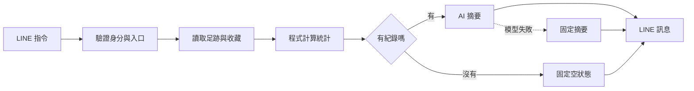

# 用既有 LINE Cafe Bot，30 天看懂 Google ADK

每天 30～45 分鐘，學一個觀念、改一小段、寫一篇短筆記。一個月後，能用自己的咖啡 Bot 說明 ADK 在做什麼，並完成十五分鐘分享。

**今天先開 [Day 01](lessons/day-01.md)，再讀 [第一篇完整概念文章](articles/day-01.md)。**

這份路線依 2026-10-24 的 GitHub 盤點設計：讀過 13 個既有 `line-cafe-*` repo 的 README、檔案樹與代表性程式，另外檢視 5 個相關專案。新 repo 原本為空。詳見 [盤點與重用建議](docs/repo-audit.md)。

## 一個月只完成這條主線

使用者要求「本月咖啡護照」→ 讀自己的足跡與收藏 → 程式計算統計 → AI 寫兩句回顧 → LINE 顯示。

選這條流程，是因為原本的 `line-cafe-passport` 已把資料、統計、摘要與訊息拆開，很適合逐步換成 ADK workflow。其他搜尋、提醒與群組功能可作延伸案例。

這是**目標架構圖**。目前交付的是學習路線、教材、文章草稿、Day 1 離線練習與最小 agent 起點；完整 ADK／Firestore／LINE 整合是每日待完成實作，尚未上線。

## 六個 phase

| Phase | 天數 | 學習重點 | 小成果 |
| --- | --- | --- | --- |
| 1 | 1～5 | Graph、ADK 與模型的分工、第一個 agent | 系統圖與 agent |
| 2 | 6～10 | Tool、參數契約、session、events | 能追蹤工具呼叫 |
| 3 | 11～15 | 順序、傳資料、分支與匯合 | 護照 workflow |
| 4 | 16～20 | 重用舊統計、adapter、摘要與 fallback | 三種本機案例 |
| 5 | 21～25 | LINE 邊界、身分、trace、驗收 | 五案例紀錄 |
| 6 | 26～30 | 比較前後、文章、demo、彩排 | 分享包與主文 |

完整每日內容、建議日期與可勾選進度在 [30 天 roadmap](ROADMAP.md)。Day 10、15、20、25、30 留作整理與補進度。

## 每天怎麼用

1. 花 8～10 分鐘讀當日 lesson，只抓一個觀念。
2. 花 15～20 分鐘做小任務；達到完成條件就停止加功能。
3. 花 10 分鐘改寫當日文章，補一張圖或一段輸出。
4. 花 2 分鐘在 [學習紀錄](learning-log.md) 記下一句理解。

只有 15 分鐘時：讀觀念、完成第一個小步驟、寫三句筆記，將未完成部分留到整理日。API、帳號或環境卡住時，先使用 fixture 完成概念與圖解。

## 從哪裡開始找

| 想做的事 | 入口 |
| --- | --- |
| 看每日進度 | [ROADMAP](ROADMAP.md) |
| 第一天就動手 | [Day 1 離線練習](examples/README.md) |
| 跑第一個 ADK agent | [TypeScript starter](examples/adk-starter/README.md) |
| 找每天教學與任務 | [lessons](lessons/README.md) |
| 讀與編輯文章 | [articles](articles/README.md) |
| 看舊 repo 如何重用 | [盤點](docs/repo-audit.md)與[遷移指南](docs/migration.md) |
| 查名詞與版本 | [概念速查](docs/concepts.md)與[官方資源](docs/resources.md) |
| 準備分享 | [demo](docs/demo.md)與[十五分鐘提綱](docs/talk.md) |

## 版本與學習範圍

沿用既有 **TypeScript**，以 **ADK 2.x 的 Workflow** 為主。官方已提供 TypeScript graph；1.x 常見的 SequentialAgent／ParallelAgent／LoopAgent 在 2.x 有棄用說明，閱讀舊文章時要區分版本。[官方 2.0 說明](https://adk.dev/2.0/)

截至查核日，官方 TypeScript Quickstart 列出 Node.js ≥24.13.0、npm ≥11.8.0；舊 Bot 的 Node 20 設定不能直接當新 ADK 環境要求。[官方 Quickstart](https://adk.dev/get-started/typescript/)

本月先理解單一 agent、唯讀 tools 與小 graph。RAG、向量資料庫、MCP、A2A、複雜多 agent、直接修改行事曆與完整雲端部署，留待有需要時延伸。學習完成與功能完成分開勾選，文章不得把計畫當成已完成成果。
