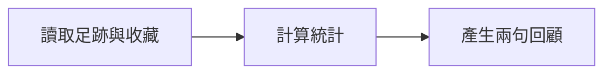

# 咖啡 Bot 已經有流程，為什麼還要認識 graph workflow？

> Day 01 · 完整概念文章草稿 · [今天的練習](../lessons/day-01.md)
> 這篇說明概念與改造方向，尚未宣稱完成 ADK 遷移。發布時可補上自己的流程圖與練習輸出。

一個咖啡 Bot 收到「幫我整理本月咖啡護照」，背後不只有一句模型提示。它得先知道發話者是誰，讀取足跡與收藏，算出造訪次數與平均分數，再把結果整理成使用者看得懂的回顧。

要認識 Google ADK，我想先從這段已經存在的工作開始。

## Graph workflow 就是一張可以執行的流程圖

Graph 可以先理解成節點與連線。節點代表一件工作，連線代表工作之間的關係。Workflow 指的是這些工作如何依規則完成。

以咖啡護照為例：

第一步取得資料，第二步算數字，第三步寫文字。因為統計需要紀錄，摘要需要統計，所以順序有理由，不能任意交換。

這張圖也能加入條件：沒有紀錄時，直接顯示如何開始累積足跡；模型服務失敗時，仍顯示程式已算出的統計與固定文案。

重點是把必要步驟、資料與例外路徑說清楚。

## 節點可以只是一般程式

「AI workflow」容易讓人以為每一格都要放 agent。但查資料、判斷是不是零筆、計算平均分數，通常適合直接用程式處理。

在這個例子裡，程式負責確定性的規則，模型負責把統計變成自然語句。若統計是三次造訪、兩家不同店，模型應該忠於這些數字，不應自己推算消費金額或使用者個性。

ADK 的 graph 可以組合一般函式、工具與 AI agent。選擇節點種類時，可以問：「這一步需要語言理解，還是已有明確規則？」

## Google ADK 放在哪裡？

Gemini 是模型；LINE 是使用者互動的入口；Firestore 保存咖啡紀錄。ADK，全名 Agent Development Kit，是用來開發與組織 agent 應用的框架，包含工具使用、執行流程與對話脈絡等能力。

使用 ADK 的 graph workflow，就是把剛才那些工作用程式定義成節點與連線，再交給執行機制驅動。它讓開發者可以明確安排哪些步驟先做、資料怎麼交接，以及條件不同時走哪一條路。

截至 2026-10-24，官方已提供 ADK 2.x 的 graph workflow，也涵蓋 TypeScript。舊文章可能仍使用 SequentialAgent、ParallelAgent 與 LoopAgent，閱讀時需要先確認版本。這輪會沿用既有 Cafe Bot 的 TypeScript。[官方 graph 說明](https://adk.dev/graphs/)、[2.0 說明](https://adk.dev/2.0/)

## 原本的函式也做得到，為什麼還要學？

這是一個合理的問題。原本 `line-cafe-passport` 的 handler 已經先讀資料，再呼叫統計、摘要與訊息組裝。若需求一直只有幾步，直接呼叫函式也很清楚。

學習 ADK 的價值，是多理解一種組織這些能力的方法。當流程加入不同分支、工具或需要觀察中途步驟時，可以比較 graph 帶來的控制與維護成本。至於是否更快、更便宜、回答更準，仍需要量測，不能從換框架直接得出結論。

所以這次先挑一條小流程，沿用原本可靠的統計，逐步接入 ADK。這樣能比較架構，也能辨認每一個改動的作用。[既有 handler](https://github.com/zonawang/line-cafe-passport/blob/main/src/handlers/passportTextHandler.ts)

## 今天的小練習

先不用申請新雲端資源。把自己的咖啡 Bot 畫成三個節點，為每個節點標出輸入、輸出，以及由程式或模型處理。

repo 內的 `examples/day01-flow.mjs` 提供一個離線的三步練習。它只是一般 JavaScript，用來感受資料在步驟間移動；真正的 ADK agent 從 Day 4 開始。

今天能解釋「為什麼先讀資料才能算統計，以及為什麼只有摘要需要 AI」，就已經抓到 graph workflow 的第一個重點。
