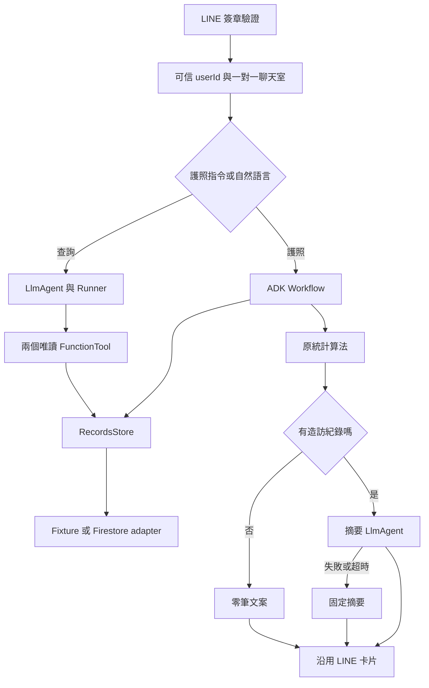

# 已實作的第一版架構

目前應用位於 application/，涵蓋護照與唯讀紀錄查詢。正式服務連線尚未驗證。

模型不能指定 ownerId。工具以閉包綁定已驗證 actor，RecordsStore 再檢查紀錄 ownerId。不同 userId／conversationId 使用不同 session。對話 Session 暫存記憶體，業務足跡仍放 Firestore。

Workflow 經 Runner 產生真實 ADK events。對外診斷只保留節點、工具與 errorCode；原始 Session 仍可能包含工具資料，持久化前需要設計存取與保留規則。

固定護照流程使用一般函式節點，模型只生成摘要。查詢 Agent 透過工具取得資料，再回答自然語言。合成 Demo 使用腳本模型；真實 Gemini 的工具選擇需另驗證。

Cloud Tasks、Maps、收藏寫入、群組功能與舊摘要快取仍留在舊應用。此次沒有切換正式 webhook。

細節：[應用說明](../application/README.md)、[實作狀態](implementation-report.md)。

