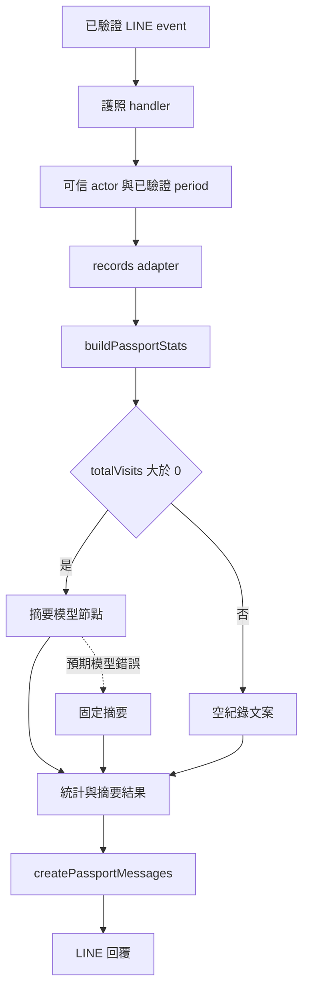

# 本月的目標架構

此頁是待逐步實作的設計。原有程式已經能產生咖啡護照，本月比較的是同一條流程如何用 ADK 組織。

| 元件 | 負責什麼 | 本月怎麼處理 |
| --- | --- | --- |
| LINE／Express | 簽章、event、actor、回覆 | 到 Day 11 才接一個護照入口 |
| ADK Workflow | 節點順序、輸入輸出與分支 | 本月新學的核心 |
| 一般 TypeScript | 日期、去重、平均分與空值 | 優先保留既有算法 |
| Gemini | 統計的短摘要 | 範圍限制在已給資料 |
| Firestore | 足跡與收藏等永久資料 | 先 fixture，再透過 adapter 接回 |
| Cloud Tasks | 指定時間觸發提醒 | 本月保留原設計，概念對照即可 |



## 三份小資料契約

以下是設計形狀，實作時需補足型別與 Zod schema。

```text
Request: { actorId, period: all | month | year }
Records: { journeys, wishlistItems }
Result:  { stats, summary, summaryMode: model | fallback | empty }
```

actorId 由驗證後的應用事件帶入，不能由模型選擇。模型只接收摘要所需的統計，不接收 LINE token 或任意使用者 ID。每個節點先寫清楚輸入與輸出，不把所有資料都放進全域物件。

## Graph 在這裡解決的問題

把必要步驟、例外分支與觀察位置表達在同一份流程定義裡。對這麼小的功能，一般函式也能做得很清楚；學習時應比較兩種組織方式的可讀性與成本。不要以「改用框架」代替實際量測或驗收。

## 後續可延伸

若本月順利完成，再選一項：附近推薦的工具轉接、收藏前確認、出發前健檢的 uncertain 分支。每次仍只增加一條能驗證的小路徑。
