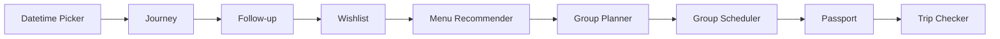

# 既有 Cafe Bot 專案盤點

查核日：2026-10-24。搜尋範圍是已連接 GitHub 帳號中，`zonawang` 擁有、名稱或 README 與 `line-cafe` 相關的可見 repositories。第一輪 `user:zonawang cafe` 找到 13 個舊 Cafe repo 與空白目標 repo；再以 `user:zonawang line-cafe in:name,description,readme` 擴查，得到四個相關專案，再沿學習歷程的連結找到 line-map-grounding。這是目前可見範圍的盤點，不代表已驗證各服務目前的部署狀態。

13 個舊 Cafe repo 都讀取 README、遞迴檔案樹，並檢視下列代表性程式；未執行各舊專案的整套測試。五個延伸 repo 本次讀 README，用來確認關係。沒有讀取真實 `.env` 或憑證。

## 13 個既有 Cafe repo

| Repo | 看到的能力 | 查閱的代表程式 | 本月用途 |
| --- | --- | --- | --- |
| [line-cafe-bot](https://github.com/zonawang/line-cafe-bot) | Webhook、Message action 的初始骨架；README 明示此版本尚未接附近搜尋。 | [src/routes/webhook.ts](https://github.com/zonawang/line-cafe-bot/blob/main/src/routes/webhook.ts) | 學入口與簽章驗證；不當完整功能基底。 |
| [line-cafe-action-agent](https://github.com/zonawang/line-cafe-action-agent) | Maps Grounding、Function Calling、收藏與待確認操作。 | [src/services/geminiActionAgent.ts](https://github.com/zonawang/line-cafe-action-agent/blob/main/src/services/geminiActionAgent.ts) | 理解手寫工具宣告與 ADK FunctionTool 的關係。 |
| [line-cafe-reminder-agent](https://github.com/zonawang/line-cafe-reminder-agent) | 自然語言提醒、Cloud Tasks、OIDC 與重試。 | [src/services/reminderScheduler.ts](https://github.com/zonawang/line-cafe-reminder-agent/blob/main/src/services/reminderScheduler.ts) | 保留排程能力；ADK workflow 不取代到時間執行的服務。 |
| [line-cafe-companion](https://github.com/zonawang/line-cafe-companion) | 個人偏好、白名單偏好值與確認後保存。 | [src/services/cafePreferences.ts](https://github.com/zonawang/line-cafe-companion/blob/main/src/services/cafePreferences.ts) | 參考 schema 與個人資料邊界。 |
| [line-cafe-rich-menu](https://github.com/zonawang/line-cafe-rich-menu) | 獨立選單圖片與管理 CLI，不提供另一個 webhook。 | [src/cli.ts](https://github.com/zonawang/line-cafe-rich-menu/blob/main/src/cli.ts) | 延用入口；無須為學 ADK 重做選單。 |
| [line-cafe-journey](https://github.com/zonawang/line-cafe-journey) | 個人足跡、評分、標籤與完成狀態。 | [src/services/journeyStore.ts](https://github.com/zonawang/line-cafe-journey/blob/main/src/services/journeyStore.ts) | 護照的足跡資料來源。 |
| [line-cafe-follow-up](https://github.com/zonawang/line-cafe-follow-up) | 安排造訪後的回訪、任務與 delivery lease。 | [src/services/reminderScheduler.ts](https://github.com/zonawang/line-cafe-follow-up/blob/main/src/services/reminderScheduler.ts) | 延伸討論持久任務與冪等；非本月實作主線。 |
| [line-cafe-wishlist](https://github.com/zonawang/line-cafe-wishlist) | 想去清單、Maps URI 去重、查詢與移除。 | [src/services/wishlistStore.ts](https://github.com/zonawang/line-cafe-wishlist/blob/main/src/services/wishlistStore.ts) | 護照的收藏資料來源。 |
| [line-cafe-menu-recommender](https://github.com/zonawang/line-cafe-menu-recommender) | 圖片辨識與飲品推薦、結構化輸出與失敗處理。 | [src/services/menuRecommender.ts](https://github.com/zonawang/line-cafe-menu-recommender/blob/main/src/services/menuRecommender.ts) | 未來可接多模態工具，本月先用文字與資料。 |
| [line-cafe-group-planner](https://github.com/zonawang/line-cafe-group-planner) | 候選店家、投票、發起人截止與票數統計。 | [src/services/groupPlanStore.ts](https://github.com/zonawang/line-cafe-group-planner/blob/main/src/services/groupPlanStore.ts) | 可用來說明確定性規則；暫不搬群組功能。 |
| [line-cafe-group-scheduler](https://github.com/zonawang/line-cafe-group-scheduler) | 時間候選、改票、平手決選與群組提醒。 | [src/services/groupScheduleStore.ts](https://github.com/zonawang/line-cafe-group-scheduler/blob/main/src/services/groupScheduleStore.ts) | 說明分支與狀態機，延伸圖解即可。 |
| [line-cafe-passport](https://github.com/zonawang/line-cafe-passport) | 期間統計、短摘要、快取與 LINE 護照卡片。 | [src/handlers/passportTextHandler.ts](https://github.com/zonawang/line-cafe-passport/blob/main/src/handlers/passportTextHandler.ts) | 本月選用的最小遷移切面。 |
| [line-cafe-trip-checker](https://github.com/zonawang/line-cafe-trip-checker) | 個人／群組出發前健檢，保守處理營業資訊不足。 | [src/services/tripChecker.ts](https://github.com/zonawang/line-cafe-trip-checker/blob/main/src/services/tripChecker.ts) | 可參考保留 uncertain 的策略；包含前序完整 Bot。 |

## 另外五個有關聯的 repo

| Repo | 關係 | 本次判讀 |
| --- | --- | --- |
| [line-map-grounding](https://github.com/zonawang/line-map-grounding) | 初始 Cafe Bot 後的 Maps Grounding 推薦版本 | 從 learning-lab 歷程連結找到，補足真實附近推薦的起點。 |
| [codex-postback-action](https://github.com/zonawang/codex-postback-action) | Maps 推薦、換一批、工作偏好與搜尋 session | 補足初始 Bot 與後續推薦版本之間的能力演進。 |
| [codex-datetime-picker-action](https://github.com/zonawang/codex-datetime-picker-action) | 日期選擇、個人偏好與 Calendar 預填連結 | journey README 明確列為前一站。 |
| [line-flex-message](https://github.com/zonawang/line-flex-message) | Flex Message 展示與咖啡菜單卡片 | 介面練習相關；未視為護照主線的正式前序。 |
| [zona-ai-learning-lab](https://github.com/zonawang/zona-ai-learning-lab) | 專題文章與專案歷程 | 可參考日常寫作的脈絡，本次文章先集中於新 repo。 |

## 可以確認的演進關係

README 明確記載的後半段串接為：

這張圖表示功能延續與文件關係，不表示 Git 的合併歷史或服務正在同時運作。Action、Reminder、Companion 與獨立 Rich Menu 也提供可參考的工具、偏好與入口設計。

## 為什麼主線挑 Passport

`handlePassportText` 的程式已經呈現清楚責任：

1. 指令對應到 `all`、`month` 或 `year`。
2. `Promise.all` 讀取 `listPassportJourneys` 與 `listPassportWishlistItems`。
3. `buildPassportStats` 用程式計算統計。
4. `getPassportSummary` 產生摘要。
5. `createPassportMessages` 組成 LINE 訊息。

另查閱 [passportStatistics.ts](https://github.com/zonawang/line-cafe-passport/blob/main/src/services/passportStatistics.ts)，確認期間、店家去重與評分聚合在一般 TypeScript 程式裡，適合保留。本月先把此流程接成 ADK graph，可以比較「框架組織方式」的差異，不需要同時解決 Maps 查詢、圖片與排程。

既有 passport 對「目前收藏後已造訪」有特定定義，不是終身收藏轉換率；統計仍受讀取筆數限制。遷移時保留這些定義與限制，避免文案放大能力。

## 建議的基底與邊界

- 學習範例：新 repo 的獨立 TypeScript 練習，使用明示的 fixture。
- 功能基準：`line-cafe-passport` 的護照相關函式與型別。
- 未來想保留最新完整功能時：可評估 `line-cafe-trip-checker`，但第一次整合仍只換護照入口。
- 舊 repo 保持作為參考；本次工作只寫入 `line-cafe-google-adk`。

這些是依原始碼提出的改造建議，尚未宣稱完成服務遷移或確認部署可用。
